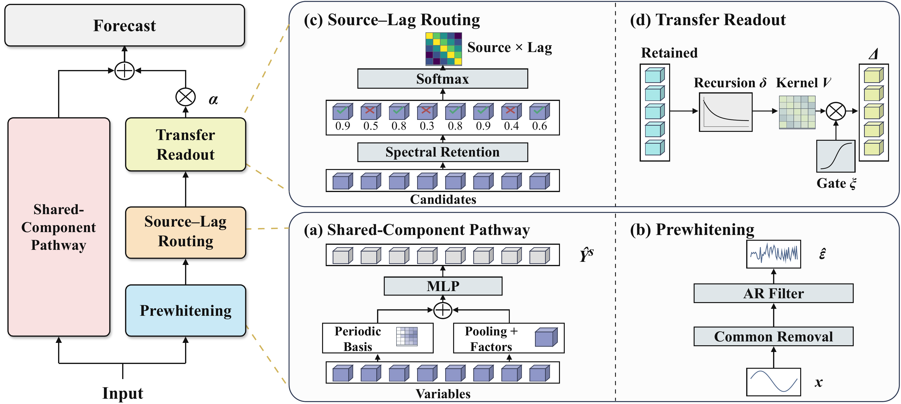

# PRELUDE

Code for *PRELUDE: Separating Common Components from Target-Specific Dependencies for Multivariate Time Series Forecasting* (under review).

## Overview

PRELUDE is a separated-reading framework for multivariate time series forecasting. A shared-component pathway estimates the common component holistically through a periodic basis table, cross-sectional pooling, and multiple common factors. An innovation pathway prewhitens the observations into innovations and reads dependencies for each target through spectral source retention, source-lag routing, and a rational transfer readout. A target-wise combination weight, solved in closed form on the validation set, adds the resulting correction to the base forecast.



## Code Structure

```
prelude/
├── model.py
├── scp.py
├── prewhiten.py
├── candidates.py
├── routing.py
├── readout.py
├── combination.py
└── metrics.py
results/
└── benchmark_per_horizon.csv
```
